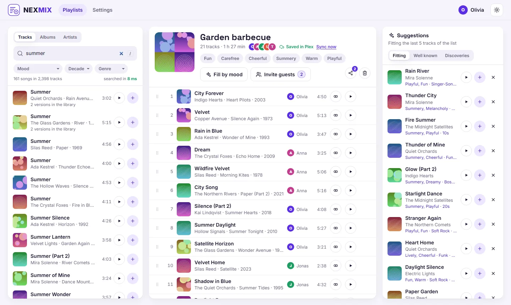
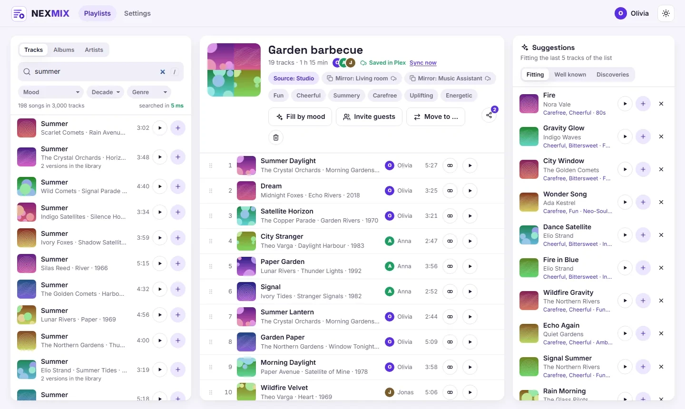
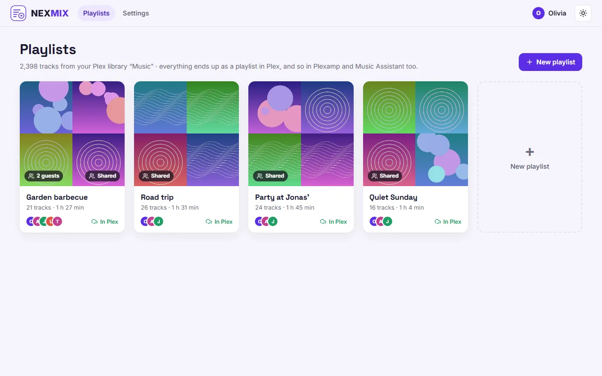
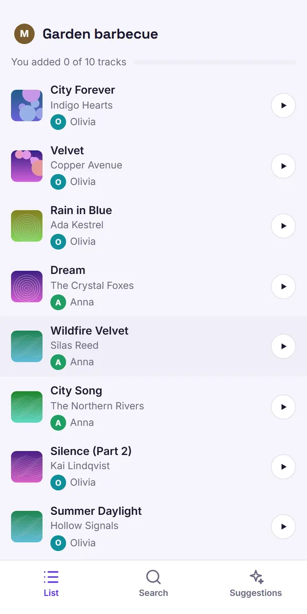
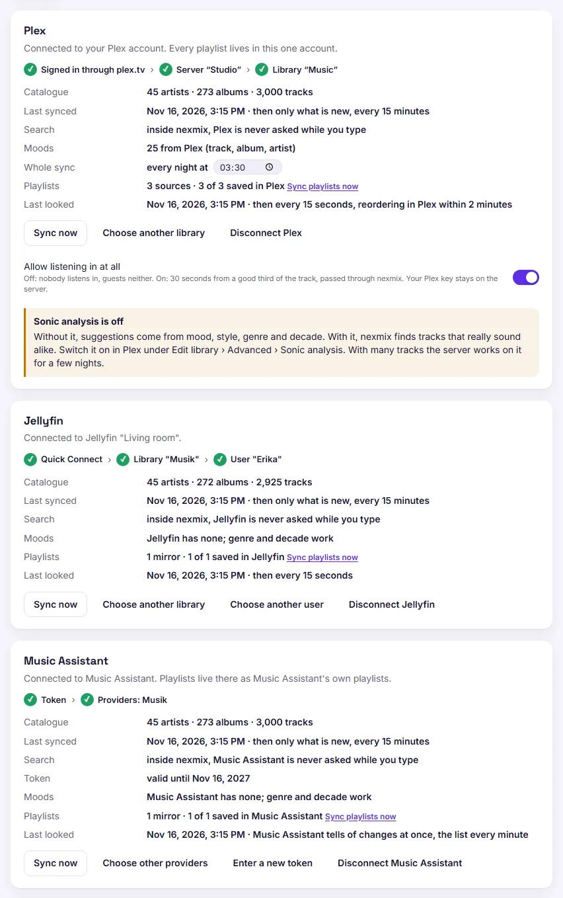
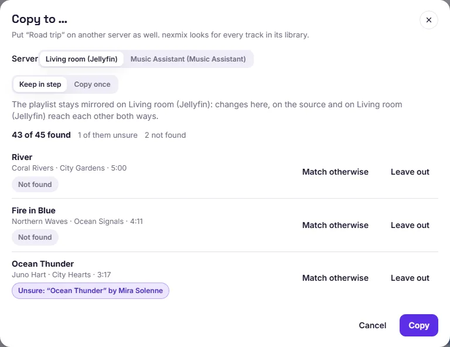

# nexmix

**Build playlists together from your music library: Plex, Jellyfin or Music Assistant.**

nexmix is a small web app for a household: everybody gets an account of their own, nobody needs an account on a media
server but the one who runs it, and guests at a party join a playlist with a link and their name. Every playlist is a
playlist on its media server too, so it plays in Plexamp, in the Jellyfin apps, in Music Assistant and wherever else
your music goes. A playlist can live on several servers at once, kept in step, which turns a move from one server to
another into a few clicks.

> **Early days.** This is the second release. It works, and it is young: back up your data folder.

<p align="center">
  <picture><source media="(prefers-color-scheme: dark)" srcset="docs/screenshots/editor-dark.webp"></picture>
</p>

## What it does

- **Playlists together.** A playlist belongs to whoever makes it and is shared with other members to look at or to
  build along. Every entry says who added it, changes reach everybody who has the playlist open at once, and taking a
  track out can be undone. Deleted playlists wait 30 days in the trash.
- **Plex, Jellyfin and Music Assistant.** The operator connects one media server or several, also several of one kind.
  Each playlist takes its tracks from one of them, its source: search, suggestions and listening in use that server's
  library, and the playlist lives there.
- **Fast search over the whole library.** nexmix fetches each server's catalogue once (then only what changed, every 15
  minutes, and the whole of it at night) and searches in the browser: no request to the server while you type. A song
  stands there once even when the library holds it on the album, a best-of and a reissue. Filters by mood, decade and
  genre; albums and artists with all their tracks.
- **Suggestions and moods.** Suggestions that fit the last tracks of the list, from the moods, styles, genres and
  decades Plex knows, from what the household's other playlists put together and, once Plex's sonic analysis is done,
  by how the tracks sound. "Fill by mood" puts a whole list together for you to tick. Jellyfin and Music Assistant
  know no moods: there genre, decade and the other playlists speak.
- **Listening in.** 30 seconds from a good third into a track, passed through the server: no token, address or id of
  a media server ever reaches a browser.
- **Every server both ways.** What changes in nexmix reaches the server about two seconds later; what is added,
  renamed or taken out in Plexamp, a Jellyfin app or Music Assistant comes into nexmix (from Music Assistant at once,
  from the others within 15 seconds), and the playlists a server already has show up. When both sides change at once,
  a three-way merge keeps every track. Smart playlists of Plex are shown and never written.
- **Mirrors, copying and moving.** "Copy to …" puts a playlist on another server as well, as a mirror kept in step
  both ways or once as a playlist of its own; "Move to …" makes another server its source. A preview says first how
  many tracks were found there, and what is missing or unsure is matched by hand or left out. "Take all over" does
  it for every playlist at once. Copying, moving, sharing, inviting guests, renaming and deleting work from the
  editor and from the menu "…" of the playlist's card alike.
- **Guests by a link or a QR code.** A guest types a name, with no account and no app, and sees only that one
  playlist. The invitation says whether guests may add, sort and listen in, how many tracks each may bring and how
  long it lasts; ending it or taking a guest out works at once.
- **Accounts the way the other nex apps do them.** Passwords, a second factor (the operator may require it for
  everybody), passkeys, sign-in through OpenID Connect providers (authentik with a one-step setup, Pocket ID, Keycloak,
  Authelia, Microsoft Entra ID), invitations for members, light and dark, German and English.
- **An interface for programs** under `/api/v1` with device tokens and read-only API keys ([docs/api.md](docs/api.md)).

<p align="center">
  <picture><source media="(prefers-color-scheme: dark)" srcset="docs/screenshots/mirror-dark.webp"></picture>
</p>

<p align="center">
  <picture><source media="(prefers-color-scheme: dark)" srcset="docs/screenshots/overview-dark.webp"></picture>
  <picture><source media="(prefers-color-scheme: dark)" srcset="docs/screenshots/guest-dark.webp"></picture>
</p>

## Start

```yaml
services:
  nexmix:
    image: ghcr.io/derkezorm/nexmix:latest
    container_name: nexmix
    restart: unless-stopped
    ports:
      - "127.0.0.1:8620:8000"
    security_opt:
      - no-new-privileges:true
    read_only: true
    tmpfs:
      - /tmp:size=256m,mode=1777
    cap_drop:
      - ALL
    cap_add:
      - CHOWN
      - DAC_READ_SEARCH
      - SETUID
      - SETGID
    volumes:
      - ./data:/data
    environment:
      PUID: 1000
      PGID: 1000
      TZ: Europe/Berlin
```

```sh
docker compose up -d
```

Open `http://127.0.0.1:8620`. The first account is the operator; it needs the setup code from `docker logs nexmix`.
Then, in **Settings, Server, Media servers**, connect a media server ([below](#media-servers)) and wait for its first
catalogue (a library of 50,000 tracks takes a minute or a few).
A second factor is not required from the start; for a server on the internet, turn it on in **Settings, Sign-in**
("Ready for the internet?" says so).
`docker-compose.yml` in this repository builds from source and explains every option.

Locked out without a mail server: `docker exec -it -u $PUID:$PGID nexmix python -m app.reset_link <account>` makes a
password link that works once.

### Updating

```sh
docker compose pull && docker compose up -d
```

The database moves to the new version by itself at the start. When a version changes the database, a backup of the
old state is made first and kept in `data/backups/` (**Settings, Backup** restores it).

## Media servers

<p align="center">
  <picture><source media="(prefers-color-scheme: dark)" srcset="docs/screenshots/servers-dark.webp"></picture>
</p>

Every server is connected in **Settings, Server, Media servers**; with more than one, each has a tab of its own there,
beside "Add a server" and "Take all over". The first one is the source of a new playlist unless another is chosen.
Give nexmix an address it reaches directly, best one inside your own network.

### Plex

Sign in at plex.tv (typing an address and a token by hand is the fallback), choose the server and the music library.
The playlists live in that Plex account. **Add a server, Plex** connects a second Plex server beside the first.

### Jellyfin

1. **Add a server, Jellyfin**, and the address (for instance `http://jellyfin:8096`).
2. **Quick Connect**: nexmix shows a six-digit code; enter it in Jellyfin under your profile, Quick Connect (it must be
   switched on in Jellyfin's dashboard). nexmix never sees a password. Or make an **API key** in Jellyfin (Dashboard,
   API Keys) and enter it instead. An API key has the full rights of an administrator in Jellyfin, and nexmix keeps
   it: Quick Connect with a user of its own who is no administrator is the narrower way
   ([SECURITY.md](SECURITY.md#media-servers)).
3. Choose the music library and the **Jellyfin user** the playlists will belong to there. nexmix makes them public, so
   that the other users of Jellyfin see them too, and that user's play counts tell nexmix which tracks are well known.
   Playlists made in Jellyfin come into nexmix only when it is connected as that user by Quick Connect: with an API
   key it cannot tell whose a playlist is.

Jellyfin hands out sound and pictures to anybody who knows an id. nexmix fetches both itself and never passes an id or
the address on to a browser or a guest.

### Music Assistant

1. In Music Assistant, open your profile and make a **long-lived token**. Its user must have the **admin role**: nexmix
   must be able to cancel a change of its own there that it gave up waiting for. A token of any other user is refused
   when connecting, and should the user lose the role later, nexmix stops taking tracks out and sorting there. The
   token reaches all of Music Assistant and nexmix keeps it; protect nexmix and its backups accordingly
   ([SECURITY.md](SECURITY.md#media-servers)).
2. **Add a server, Music Assistant**, the address (for instance `http://music-assistant:8095`) and the token.
3. Choose the **providers** whose tracks count. Leave out a provider that is a Plex or Jellyfin server nexmix also
   knows directly (nexmix says which): its tracks would stand twice, once for each server.

A long-lived token lasts a year; nexmix warns 30 days before it runs out, and so does "Ready for the internet?". The
playlists are Music Assistant's own (provider `builtin`); its dynamic playlists are left alone.

## Mirrors, copying and moving

<p align="center">
  <picture><source media="(prefers-color-scheme: dark)" srcset="docs/screenshots/copy-dark.webp"></picture>
</p>

A playlist takes its tracks from one server, its **source**, and may be **mirrored** on others: a playlist there with
the tracks of that server that stand for its entries, kept in step both ways like the source.

- **Copy to …** looks for every track on the other server and shows first how many it found. A track found only by
  its song (another version, perhaps) is marked unsure; a missing or unsure one is matched by hand through a search in
  that library, or left out. "Keep in step" makes a mirror; "Copy once" makes a new playlist with that server as its
  source and no tie to the first one.
- **Move to …** makes the other server the source; the playlist on the old one stays as a mirror or is deleted there.
  An entry without a counterpart keeps its own track and says so.
- **Take all over** (on the card of the server you move to) does the same for every playlist at once, as mirrors or
  moved, with the same preview, in the background. It can let go of the old server afterwards; a server is never let
  go of while a playlist still takes its tracks from it, so nothing is lost on the way.
- A track added in a mirror is looked for in the source: found for sure, it becomes an entry; else it waits at the
  playlist as "only on <server>" until somebody decides. An entry without a track on a mirror's server is not in that
  mirror ("Not on <server>").

Tracks are matched by their MusicBrainz id, then by title, album artist and album, then by title, artist and length,
and last by the song alone (unsure).

## Limits

- Moods, styles and the sonic analysis come from Plex only.
- **Music Assistant names no entry of a playlist.** nexmix takes entries out there by their place, read the moment
  before, and reads the playlist again afterwards. When somebody changes the same playlist in Music Assistant at that
  moment, nexmix waits and merges again; when a track added there right then may have been taken out instead, the
  playlist says "Changed in Music Assistant at the same time" with how many (Music Assistant does not say which
  track). Look there and add it again if it is missing.
- Music Assistant cannot move an entry or rename a playlist: a new order takes everything from the first entry out of
  place out and puts it back; a new name makes a new playlist and copies every entry over.
- Jellyfin drops an entry without a word when its file is renamed or moved. nexmix keeps the entry, marked as missing
  there, and puts it back after the next run of the catalogue.
- Changes on both sides at the same moment are merged; when both sorted, nexmix's order wins and the other one can be
  taken back from a note. What nexmix will not decide alone (a mirror emptied on its server, many entries lost at
  once, tracks only on a mirror) waits at the playlist as a note.

## Environment

| Variable | Default | Meaning |
|---|---|---|
| `NEXMIX_PUBLIC_URL` | from the request | The address people use; the setting in the interface wins |
| `NEXMIX_TRUSTED_PROXIES` | none | Reverse proxies whose `X-Forwarded-For` and `X-Forwarded-Proto` count, comma separated |
| `NEXMIX_SETUP_TOKEN` | made at start | The code the first account needs |
| `NEXMIX_OPERATOR_NETWORKS` | none | Networks the operator's settings may be changed from |
| `NEXMIX_API_DOCS` | `false` | Serves the description of the API (`/api/v1/openapi.json`, `/api/v1/docs`) |
| `NEXMIX_DATA_DIR` | `/data` | Database, logs, backups, secrets; `NEXMIX_LOCALES_DIR` holds extra languages |
| `NEXMIX_SECRET_KEY` | made on first start | Protects server-side secrets |
| `NEXMIX_SESSION_DAYS` | `30` | Days a remembered session lasts without use |
| `NEXMIX_COOKIE_SECURE`, `NEXMIX_COOKIE_SUFFIX` | `auto`, none | Secure flag of the cookies; a suffix keeps two instances on one host apart |
| `NEXMIX_LOG_LEVEL` | stored setting | `quiet`, `normal`, `detailed` or `trace` |
| `NEXMIX_DECODE_SLOTS` | `1` | Pictures unpacked at the same moment |
| `NEXMIX_COVER_CACHE_MB` | `200` | Room for the album covers kept on disk |
| `NEXMIX_SERVER_SEARCH_FROM` | `150000` | Past this many tracks the interface searches on the server instead of in the browser |
| `PUID`, `PGID`, `TZ` | `1000`, `1000`, none | Owner of the data directory, time zone of the log and of the nightly sync of the catalogue |

Set by the image or used by the tests only: `NEXMIX_PORT`, `NEXMIX_FRONTEND_DIST`, `NEXMIX_UPDATE_URL`,
`NEXMIX_DISABLE_BACKGROUND`, `NEXMIX_ARGON2_TIME`, `NEXMIX_ARGON2_MEMORY_KIB`, `NEXMIX_ARGON2_PARALLELISM`,
`NEXMIX_PLEX_TV_URL`, `NEXMIX_PLEX_AUTH_URL`.

Everything else is set in the interface: the media servers, the nightly sync, listening in, the defaults of invitations, sign-in
providers, mail, Web Push, backups, the log, API keys.

## Behind a reverse proxy

nexmix speaks plain HTTP on port 8000 inside the container. For anything beyond your own machine, put a reverse proxy
with https in front, set `NEXMIX_PUBLIC_URL` (or **Settings, Sign-in, Public address**) and name the proxy in
`NEXMIX_TRUSTED_PROXIES`, so that the brakes against guessing see the real sender and cookies are marked secure.
**Settings, Sign-in, Ready for the internet?** checks all of it.

The live updates of an open playlist and listening in are long answers: the proxy must pass them on as they come and
not cut them after a few seconds. Caddy does that as it is:

```
mix.example.com {
    reverse_proxy 127.0.0.1:8620
}
```

With nginx, turn the buffering off for the interface:

```nginx
location / {
    proxy_pass http://127.0.0.1:8620;
    proxy_set_header Host $host;
    proxy_set_header X-Forwarded-For $proxy_add_x_forwarded_for;
    proxy_set_header X-Forwarded-Proto $scheme;
    proxy_buffering off;
    proxy_read_timeout 1h;
}
```

## Guests from outside

A guest's link is `<public address>/j/<code>`. Phones in your Wi-Fi reach nexmix at its address in your network;
phones on mobile data need the public address with https. The invitation dialog says when the address it uses cannot
be reached from outside, and the operator sets the right one in **Settings, Sign-in**.

What a guest reaches is the page of the link, the one playlist, the search, suggestions, covers and, where the
invitation allows it, listening in: never another playlist, an account or a setting. A code has 12 characters (about
8·10^17 possibilities); wrong codes are braked per sender, and a sender who guesses never locks the guests of a party
out. Whoever has the link can slow joining down (one address gets 60 joins in ten minutes, an invitation 300): then end
the invitation and make a new one. Ending the invitation puts every guest out at once.

## Privacy

nexmix keeps its data in the data folder and nowhere else: the accounts, the playlists with who added what, the shares,
the invitations with the guests' names, and a copy of the catalogue of each library (titles, artists, albums,
moods, the covers it showed). The music stays on the media servers. A guest leaves a name and nothing else; the cookie of a guest
lasts as long as the invitation.

The server talks to your media servers, to plex.tv while you connect Plex, and, if you set them up, to a mail server, the push
services of the browsers and the sign-in providers. Once a day it asks api.github.com whether a newer release is out
(the page **About** turns that off); nothing about you goes with it. There is no telemetry, and the interface loads no
font, script or picture from another host.

## Development

```sh
cd backend && python -m venv .venv && .venv/bin/pip install -r requirements-dev.txt
.venv/bin/python -m pytest
cd ../frontend && npm ci && npm test && npm run e2e
```

The tests never reach a real media server: `backend/tests/fakeplex`, `fakejellyfin` and `fakema` are stand-ins with a
made-up library, and the pictures in this README show them.

## License

[AGPL-3.0](LICENSE). Third-party licences: [THIRD-PARTY.md](THIRD-PARTY.md). Security reports:
[SECURITY.md](SECURITY.md).

nexmix is not affiliated with Plex Inc., the Jellyfin project or Music Assistant; Plex and Plexamp are trademarks of
Plex Inc.
